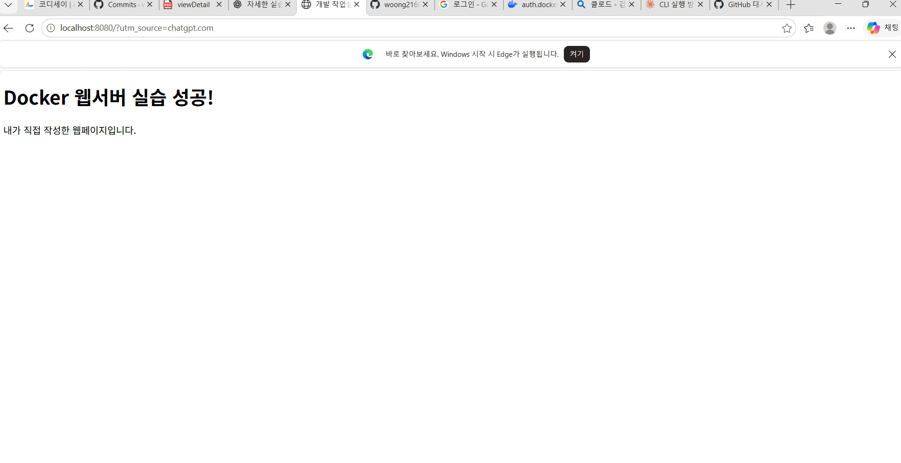
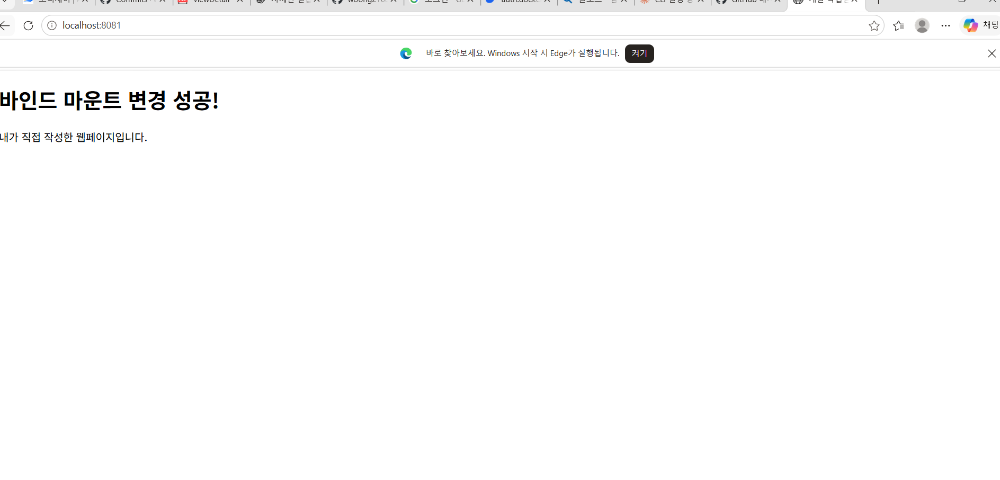
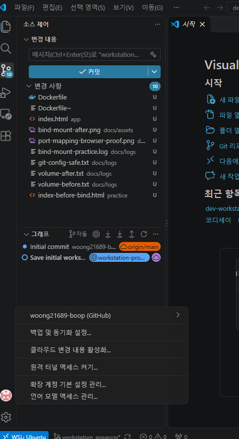

# 개발 워크스테이션 구축 실습 보고서

> 코디세이 · 입학연수 · 개발 입문 · 필수 미션 「내 컴퓨터에 개발자용 '작업실' 꾸미기」  
> **실제 실습 결과를 기반으로 작성한 보고서.** 공개 로그의 민감정보는 제출 전에 최종 점검한다.

## 1. 프로젝트 개요

이 프로젝트는 WSL Ubuntu의 Linux CLI에서 파일과 권한을 조작하고, Docker Desktop으로 컨테이너를 실행·관리하며, 직접 작성한 Dockerfile로 Nginx 웹서버 이미지를 제작하는 실습이다. 포트 매핑으로 웹페이지에 접속하고 바인드 마운트로 원본 파일 변경을 반영하며, Docker 볼륨을 통해 컨테이너 삭제 후에도 데이터가 유지됨을 검증했다. Git과 GitHub로 수행 결과를 기록·공유한다.

### 저장소 구조

```text
.
├── README.md
├── Dockerfile
├── .gitignore
├── app/
│   └── index.html
├── docs/
│   ├── assets/
│   │   ├── port-mapping-browser-proof.png
│   │   ├── bind-mount-after.png
│   │   └── vscode-github-connected.png
│   └── logs/
│       ├── terminal-practice.log
│       ├── docker-practice.log
│       ├── bind-mount-practice.log
│       ├── git-config-safe.txt
│       ├── volume-before.txt
│       └── volume-after.txt
└── practice/
    ├── test_dir/
    └── index-before-bind.html
```

*일부 `practice/` 파일은 터미널의 삭제 실습으로 사라졌을 수 있다. 트리의 `practice/test_dir`는 실습 경로를 설명하기 위한 것이며 실제 제출 상태는 저장소의 파일 목록을 우선한다.*

## 2. 실행 환경

| 구성 요소 | 실제 확인 결과 |
|---|---|
| 호스트 OS | Windows 11 Pro 26H2 (OS 빌드 26300.9711) + WSL 2 |
| Linux 배포판 | Ubuntu 26.04.1 LTS |
| Shell / CLI | Bash, Ubuntu 터미널 |
| Docker CLI / Engine | **29.9.2** / **29.9.2** |
| Docker Desktop | **4.97.0** (`docker info`의 CLI 플러그인에 표시) |
| Docker 서버 OS | Docker Desktop, Linux x86_64 |
| 서버 자원 표시 | CPU 8개, 메모리 7.605 GiB (`docker info` 출력 기준) |
| Git | 2.53.0 |
| 편집기 | Visual Studio Code, WSL 환경 연동 |
| 웹서버 | Nginx 1.31.8 (실제 HTTP 응답 헤더 기준) |

확인에 사용한 대표 명령:

```bash
pwd
cat /etc/os-release
git --version
docker --version
docker info
```

실제 출력 중 확인된 값:

```text
Docker version 29.9.2, build a82e528
Server Version: 29.9.2
Operating System: Docker Desktop
OSType: linux
Architecture: x86_64
CPUs: 8
Total Memory: 7.605GiB
```

## 3. 수행 체크리스트

- [x] 터미널의 현재 경로·목록·숨김 파일 확인, 디렉터리 이동·생성
- [x] 빈 파일 생성, 파일 내용 출력, 복사·이동·이름 변경·삭제
- [x] 파일과 디렉터리의 권한 변경 전후 확인
- [x] Docker 버전·데몬 점검 및 `hello-world` 실행
- [x] 이미지·컨테이너 목록, 로그 및 자원 사용량 확인
- [x] Ubuntu 컨테이너의 `attach`·`exec`, 종료·재시작 비교
- [x] 직접 작성한 Dockerfile로 커스텀 이미지 빌드
- [x] 포트 매핑 후 브라우저와 `curl`로 웹서버 검증
- [x] 바인드 마운트 연결 및 변경 전후 비교
- [x] Docker 볼륨의 컨테이너 삭제 전후 데이터 보존 확인
- [x] Git 설정 및 VS Code·GitHub 연동
- [x] 실제 문제 해결 사례 2건 정리
- [ ] 공개 제출 자료의 민감정보 최종 점검
- [ ] GitHub에 최종 변경 사항 커밋·푸시 및 링크 검수

## 4. 핵심 개념 설명

**절대 경로**는 `/home/사용자/dev-workstation-environment`처럼 루트(`/`)부터 시작하는 전체 경로이고, **상대 경로**는 현재 위치를 기준으로 한 `practice/test_dir` 같은 경로다.

파일 권한의 `r`은 읽기(4), `w`는 쓰기(2), `x`는 실행(1)을 의미한다. 디렉터리에서는 `x`가 내부 경로 접근 권한을 뜻한다. `644`는 소유자에게 읽기·쓰기, 그룹과 기타 사용자에게 읽기 권한을 준다. `755`는 소유자에게 읽기·쓰기·접근, 그룹과 기타 사용자에게 읽기·접근 권한을 준다.

**Docker 이미지**는 실행에 필요한 프로그램과 파일을 묶은 원본이며, **컨테이너**는 이 이미지로 만들어 실행하는 인스턴스다. `docker run`은 새 컨테이너를 만들고 `docker start`는 기존 컨테이너를 다시 시작한다.

**포트 매핑**은 호스트의 접속 포트와 컨테이너 내부 서비스 포트를 연결한다. **바인드 마운트**는 호스트가 지정한 파일·폴더를 컨테이너에서 읽게 하고, **이름 있는 Docker 볼륨**은 컨테이너 수명과 분리해서 데이터를 저장한다.

**Git**은 로컬 변경 이력을 관리하는 도구이고 **GitHub**는 Git 저장소를 원격으로 호스팅·공유하는 협업 플랫폼이다.

## 5. Linux 터미널·파일 조작 실습

실습 위치: `~/dev-workstation-environment/practice` 아래 `test_dir`.

```bash
pwd
mkdir -p test_dir/sub_dir
cd test_dir
touch sample.txt
echo "Hello Linux" > sample.txt
cat sample.txt
touch .hidden_config
ls -la
cp sample.txt sample_copy.txt
cat sample_copy.txt
mv sample_copy.txt sub_dir/renamed_sample.txt
ls -la sub_dir
cat sub_dir/renamed_sample.txt
rm sub_dir/renamed_sample.txt
rmdir sub_dir
ls -la
```

관찰된 주요 출력:

```text
Hello Linux
.hidden_config
sample.txt
```

숨김 파일을 포함하는 전체 목록은 `ls -la`로 확인했고, 삭제 후에는 원본 `sample.txt`와 숨김 파일이 남아 있었다. 명령과 터미널 출력의 원본 기록: [터미널 실습 로그](docs/logs/terminal-practice.log).

### 파일과 디렉터리 권한

```bash
touch test_perm_file.txt
mkdir -p test_perm_dir
chmod 644 test_perm_file.txt
chmod 755 test_perm_dir
ls -ld test_perm_file.txt test_perm_dir
chmod 600 test_perm_file.txt
chmod 700 test_perm_dir
ls -ld test_perm_file.txt test_perm_dir
chmod 644 test_perm_file.txt
chmod 755 test_perm_dir
ls -ld test_perm_file.txt test_perm_dir
```

변경 전후의 실제 권한:

```text
변경 전: drwxr-xr-x  test_perm_dir
변경 전: -rw-r--r--  test_perm_file.txt
변경 후: drwx------  test_perm_dir
변경 후: -rw-------  test_perm_file.txt
원복 후: 755(폴더), 644(파일)
```

## 6. Docker 설치·운영 및 컨테이너 실습

WSL Ubuntu에서 Docker Desktop WSL Integration을 활성화하고, Docker 소켓 접근 권한 문제를 해결한 뒤 다음 명령으로 점검했다.

```bash
docker --version
docker info
docker run --rm hello-world
docker images
docker ps
docker ps -a
```

성공 출력:

```text
Hello from Docker!
This message shows that your installation appears to be working correctly.
```

`hello-world`를 `--rm`으로 실행했기 때문에 이미지가 남아 있어도 종료된 컨테이너는 목록에 남지 않았다.

### Ubuntu 컨테이너 실행·유지·종료

초기 대화형 컨테이너 실습에서는 실제 목록에 **`ubuntu:23.04`** 이미지로 표시된 `ubuntu-lab`을 사용했다. 별도의 볼륨 실습에는 `ubuntu:24.04`를 사용했다.

```bash
docker run -it --name ubuntu-lab ubuntu:23.04 bash
# 컨테이너 안에서
echo Docker_Test > /tmp/result.txt
cat /tmp/result.txt
# Ctrl+P, Ctrl+Q로 연결만 분리
# 호스트에서
docker ps --filter name=ubuntu-lab
docker exec -it ubuntu-lab bash
# 추가 셸 안에서
cat /tmp/result.txt
exit
# 호스트에서
docker ps --filter name=ubuntu-lab
docker attach ubuntu-lab
# 주된 Bash에 연결된 상태에서
exit
# 호스트에서
docker ps -a --filter name=ubuntu-lab
docker start -ai ubuntu-lab
```

실제로 `Docker_Test`를 읽었고, `docker exec`로 연 셸을 종료한 뒤에도 컨테이너는 `Up` 상태였다. 반면 `attach`한 주된 Bash에서 `exit`한 후에는 `Exited (0)`으로 표시되었다. 초기 실습 이미지인 Ubuntu 23.04는 지원이 종료된 버전이므로 이후 새로운 실습은 24.04 이미지로 수행했다.

## 7. Dockerfile 기반 커스텀 웹서버 이미지

**선택 방식: A — 기존 Nginx 기반 이미지에 직접 만든 정적 콘텐츠를 복사.**

`Dockerfile` 주요 내용:

```dockerfile
FROM nginx:alpine

LABEL org.opencontainers.image.title="workstation-web"

COPY app/index.html /usr/share/nginx/html/index.html

EXPOSE 80
```

- `FROM`: Nginx 웹서버가 포함된 경량 이미지 사용
- `LABEL`: 이미지의 용도 표시
- `COPY`: 직접 작성한 HTML을 Nginx의 웹 루트에 복사
- `EXPOSE`: 컨테이너 서비스 포트 80을 문서화 (호스트 공개는 별도의 `-p`로 설정)

웹페이지 원본: [app/index.html](app/index.html). 빌드 및 이미지 목록 확인:

```bash
docker build -t workstation-web:1.0 .
docker images workstation-web
```

관찰 결과:

```text
[+] Building 1.0s (7/7) FINISHED
naming to docker.io/library/workstation-web:1.0
workstation-web:1.0   f546c2992e27   93.6MB   26.3MB
```

## 8. 포트 매핑 및 웹 서버 접속 검증

```bash
docker run -d --name workstation-web-8080 -p 127.0.0.1:8080:80 workstation-web:1.0
docker ps --filter name=workstation-web-8080
curl -I http://127.0.0.1:8080
docker logs --tail 10 workstation-web-8080
docker stats --no-stream workstation-web-8080
```

실제로 확인한 핵심 출력:

```text
STATUS: Up 11 minutes
PORTS: 127.0.0.1:8080->80/tcp
HTTP/1.1 200 OK
Server: nginx/1.31.8
CPU: 0.00%
MEM USAGE: 9.855MiB / 7.605GiB
```

브라우저에서 직접 제작한 제목 **“Docker 웹서버 실습 성공!”**과 본문 **“내가 직접 작성한 웹페이지입니다.”**가 출력되었다.



로그의 `favicon.ico` 요청에서 404가 발생했지만, 실제 페이지 `GET /` 및 `HEAD /` 요청은 200으로 정상 처리되었다.

## 9. 바인드 마운트 변경 전·후 비교

이미지에 복사한 페이지(8080)와 호스트 폴더를 연결한 페이지(8081)를 비교했다.

```bash
docker run -d --name workstation-web-bind -p 127.0.0.1:8081:80 -v "$PWD/app:/usr/share/nginx/html:ro" nginx:alpine
curl -s http://127.0.0.1:8081 | grep '<h1>'
cp app/index.html practice/index-before-bind.html
sed -i 's/Docker 웹서버 실습 성공!/바인드 마운트 변경 성공!/' app/index.html
curl -s http://127.0.0.1:8081 | grep '<h1>'
curl -s http://127.0.0.1:8080 | grep '<h1>'
```

실제 비교 결과:

```text
수정 전 8081: <h1>Docker 웹서버 실습 성공!</h1>
수정 후 8081: <h1>바인드 마운트 변경 성공!</h1>
수정 후 8080: <h1>Docker 웹서버 실습 성공!</h1>
```

즉, **이미지를 다시 빌드하거나 컨테이너를 다시 시작하지 않아도 8081의 페이지가 변경되었다.** 변경된 화면:



실습 후 `cp practice/index-before-bind.html app/index.html`로 원본을 복원했고, 8081에서 원래 제목이 다시 표시됨을 확인했다. 명령 기록: [바인드 마운트 로그](docs/logs/bind-mount-practice.log).

## 10. Docker 볼륨 영속성 실험

```bash
docker volume create workstation-data
docker volume ls
docker run -d --name volume-writer -v workstation-data:/data ubuntu:24.04 sleep infinity
docker exec volume-writer sh -c 'echo VOLUME_OK > /data/hello.txt'
docker exec volume-writer cat /data/hello.txt
# 삭제 전 결과를 증거 파일에 저장
docker exec volume-writer cat /data/hello.txt | tee docs/logs/volume-before.txt
docker stop volume-writer
docker rm volume-writer
docker ps -a --filter name=volume-writer
docker volume ls
docker run --rm --name volume-reader -v workstation-data:/data:ro ubuntu:24.04 cat /data/hello.txt
docker run --rm -v workstation-data:/data:ro ubuntu:24.04 cat /data/hello.txt | tee docs/logs/volume-after.txt
cmp docs/logs/volume-before.txt docs/logs/volume-after.txt && echo "VOLUME_TEST_PASSED"
```

실제 확인 결과:

```text
삭제 전: VOLUME_OK
volume-writer 컨테이너: 삭제됨
workstation-data 볼륨: 남아 있음
새 컨테이너에서 읽기: VOLUME_OK
VOLUME_TEST_PASSED
```

증거: [삭제 전 데이터](docs/logs/volume-before.txt) · [삭제 후 데이터](docs/logs/volume-after.txt).

## 11. Git 설정·VS Code·GitHub 연동

```bash
git config --global init.defaultBranch main
git config --list
git branch --show-current
git remote -v
git status
```

개인정보를 가린 제출용 핵심 설정 결과:

```text
user.name=userwoong2168
user.email=[MASKED]
init.defaultbranch=main
```

[마스킹한 Git 설정 로그](docs/logs/git-config-safe.txt)

GitHub 사용자 `woong21689-boop`으로 로그인했고, 과제 저장소는 공개 저장소 [`woong21689-boop/-`](https://github.com/woong21689-boop/-)이다. 과제 작업은 `workstation-progress` 브랜치에서 진행했고, 해당 브랜치를 기본 브랜치로 설정했다. VS Code 소스 제어 화면에서 브랜치와 GitHub 로그인 계정을 확인했다.



## 12. 실제 트러블슈팅

### 사례 1 — Docker API 접근 권한 오류

**문제:** Ubuntu에서 `docker run --rm hello-world`를 실행했을 때 `/var/run/docker.sock`에 대해 `permission denied`가 나왔다. 이후 WSL 재시작 과정에서는 Docker 엔진이 실행되지 않아 `no such file or directory` 오류도 발생했다.

**원인 가설:** 현재 사용자에게 `docker` 그룹 권한이 없거나, Docker Desktop WSL Integration / 엔진 연결이 정상적으로 적용되지 않았을 수 있다.

**확인:**

```bash
ls -lL /var/run/docker.sock
id -nG
getent group docker
```

실제로 Docker 소켓은 `root docker` 소유였고 최초 `id -nG` 출력에는 `docker`가 없었다. `getent group docker`로 계정 등록을 확인했다.

**해결:** 개인 개발 PC에서 필요한 권한을 부여했다.

```bash
sudo usermod -aG docker "$USER"
```

Ubuntu를 다시 시작한 뒤 `id -nG`에 `docker`가 표시되었다. Docker Desktop을 실행하고 WSL Integration을 확인한 후 `Hello from Docker!`가 정상 출력됐다. (`docker` 그룹은 강한 권한을 부여하므로 신뢰하는 로컬 개발 계정에서만 사용한다.)

### 사례 2 — GitHub 원격 저장소를 찾지 못함

**문제:** `git push -u origin main` 실행 시 `Repository not found`가 출력됐다.

**원인 가설:** 원격 URL에 적힌 저장소 이름과 실제 GitHub에 생성된 저장소 이름이 다를 수 있다.

**확인:**

```bash
gh auth status
gh repo list woong21689-boop --limit 100
git remote -v
```

처음 연결된 주소는 `woong21689-boop/dev-workstation-environment`였지만 실제 존재하는 저장소의 이름은 `woong21689-boop/-`였다.

**해결:** 올바른 주소로 연결을 수정했다.

```bash
git remote set-url origin https://github.com/woong21689-boop/-.git
git ls-remote --heads origin
git fetch origin
```

원격 `main`에 이미 별도 `Initial commit`이 있어 기존 기록을 강제로 덮어쓰지 않고, 과제 기록을 `workstation-progress` 브랜치에 푸시한 뒤 기본 브랜치로 지정했다.

```bash
git push origin main:workstation-progress
gh repo edit woong21689-boop/- --default-branch workstation-progress
```

`[new branch]` 및 `✓ Edited repository` 성공 메시지를 확인했다.

## 13. 재현 방법

**주의:** 다음 절차는 Docker Desktop이 설치·실행 중이고, WSL Ubuntu에서 Docker CLI가 연결된 환경을 전제로 한다. 타인의 PC에서는 사용자별 경로가 다르므로 `~`와 `$PWD`처럼 현재 작업 폴더 기준으로 사용한다.

```bash
# GitHub 저장소 내려받기: 저장소 이름이 '-'여서 로컬 폴더명은 별도 지정
git clone https://github.com/woong21689-boop/-.git workstation-lab
cd workstation-lab

# 직접 만든 정적 웹서버 이미지 빌드
docker build -t workstation-web:1.0 .

# 최초 재현 시 사용할 컨테이너 이름 및 포트
docker run -d --name workstation-web-8080 -p 127.0.0.1:8080:80 workstation-web:1.0
curl -I http://127.0.0.1:8080

# 바인드 마운트 비교용 웹서버
docker run -d --name workstation-web-bind -p 127.0.0.1:8081:80 -v "$PWD/app:/usr/share/nginx/html:ro" nginx:alpine
curl -s http://127.0.0.1:8081 | grep '<h1>'
```

웹브라우저에서 `http://localhost:8080`과 `http://localhost:8081`에 접속한다. 컨테이너 이름이나 포트가 이미 사용 중이면 기존 상태를 먼저 확인하고 충돌하지 않는 이름·포트를 선택한다. 컨테이너·볼륨 삭제 명령은 본인의 실습 자원인지 확인한 경우에만 사용한다.

## 14. 보안·제출 확인

- GitHub 저장소는 **공개(Public)** 상태로 유지하여 교육 담당자가 링크로 접근할 수 있게 한다.
- 비밀번호, GitHub 인증 토큰, 개인키, 일회용 로그인 코드 등을 README·로그·스크린샷에 포함하지 않는다.
- `script`로 수집한 `*.log`에는 ANSI 제어문자가 포함될 수 있다. 이는 실패를 의미하지 않으며, 공개 전 전체 내용을 검토·마스킹해야 한다.
- `Dockerfile~` 같은 편집기 백업 파일은 제출 대상에서 제외한다.
- 코드·문서·이미지의 Git 변경 사항을 커밋하고 푸시한 후, 웹에서 기본 브랜치의 파일과 이미지 링크가 실제로 열리는지 확인한다.

**최종 제출 링크:** https://github.com/woong21689-boop/-
